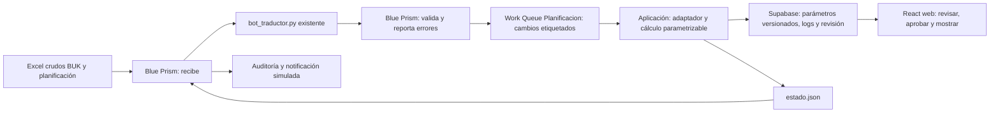

# Botathon Puerto Montt · Equipo 35 · Cada hora cuenta

Prototipo web de planificación asistencial de Teletón. **Blue Prism es obligatorio** y su trabajo debe verse en la demo: recepción, traducción, validación, Work Queue, entrega del lote y auditoría.

**Prototipo de pruebas, sin despliegue.** La exactitud del cálculo queda por hacer en la siguiente etapa.

**Estado actual: integración del kit real y motor provisional.** La comparación completa obtiene 1/471 coincidencias, con 4.487/13.188 comprobaciones iguales. El cálculo oficial no está cerrado. El informe conserva las diferencias, sin copiar las respuestas de la referencia para cuadrar el resultado.

- [Aplicación, instalación y API](cada-hora-cuenta/README.md)
- [Receta concreta de Blue Prism](cada-hora-cuenta/docs/BLUE_PRISM.md)
- [Guion de demo y reporte de agosto](cada-hora-cuenta/docs/DEMO.md)
- [Cotejo de los 471 casos y límites](cada-hora-cuenta/docs/VALIDACION.md)
- [Supabase, acceso y revisiones](cada-hora-cuenta/docs/SUPABASE.md)
- [Paquete provisional v0.3.0](entregables/Botathon_Kit_v0.3.0_provisional.zip?raw=true)

## Arquitectura final

**Qué hace Blue Prism:** recibe archivos completos, ejecuta el traductor, valida las colecciones reales, informa errores, encola altas/bajas/cambios y entrega el libro a la API. No se reduce a abrir el dashboard.

**Qué hace la aplicación:** adapta las tablas del kit, permite editar reglas, calcula con vigencias y excepciones multiinstituto, compara contra la referencia de forma independiente, crea revisiones y muestra la última aprobada. La web sigue siendo React; Supabase conserva logs y revisiones. La limpieza original sigue en Python y `bot_traductor.py` no se reescribe.

**Escala a 14 institutos y 600 profesionales:** catálogos y calendario por sede, claves persona/IT/mes, proceso por lote y snapshots inmutables. El benchmark local sintético midió 600 IDs/7.030 filas, no la corrida de Blue Prism ni su VM. La aceptación exige medir el kit completo en Windows y cerrar las diferencias de cálculo.

## Arranque para la VM

Desde `cada-hora-cuenta`, instalar Node 24, Python 3.12, `npm ci` y `python -m pip install -r server/requirements.txt`. En dos terminales: `npm run api` y `npm run dev`. El flujo completo se detalla en el README de la aplicación.

## Traductor existente

`bot_traductor.py`, `LEEME.md` y `ejecutar.bat` de la raíz se conservan. El traductor produce el Excel plano que consume ahora la API. En este repositorio está una salida plana de ejemplo; los dos crudos originales no se adjuntaron a la sesión, por lo que la prueba de generación usa una reconstrucción mínima claramente identificada como QA.

Se usó IA (Codex) para programación y documentación. No subir credenciales de VM/Blue Prism/Supabase ni datos identificables de pacientes o profesionales.
