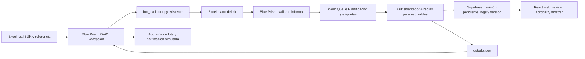

# Receta VM · Blue Prism en el centro

Esta receta implementa el proceso visible del bot. No es un `.bprelease` ejecutado: una persona del equipo debe montarlo y comprobar las entradas/salidas de los VBO instalados en la VM. No se declara una ejecución real de Blue Prism desde este entorno Linux.

## Preparación concreta

- Clonar el repositorio en `C:\Botathon\repo\`. Proyecto web/API: `C:\Botathon\repo\cada-hora-cuenta\`.
- Instalar Python y `pip install -r requirements.txt` desde la raíz. No reescribir `bot_traductor.py`.
- Carpetas: `entrada`, `referencia`, `lotes`, `procesados`, `rechazados`, `notificaciones` bajo `C:\Botathon\`.
- El reporte base se llama `Nac - Base contratos x mes.xlsx`; la referencia, `Nac - Planificación Asistencial x mes.xlsx`.
- Iniciar API, desde `cada-hora-cuenta`: `python -m server.app --port 8765 --data-dir work/calculation --token-file work/api-token`. El token se genera en archivo privado: no pasarlo como argumento ni imprimirlo.
- Crear Work Queue **Planificacion** en System → Workflow → Work Queues. Key: `huella-lote|PersonaId-IT-Mes|Tipo_Cambio`. Las claves deben comprobarse antes de agregar; no asumir que Blue Prism impone unicidad automáticamente.
- Importar los VBO estándar **Utility - File Management**, **Utility - Environment**, **MS Excel VBO**, **Utility - Collection Manipulation**. Usar **Internal - Work Queues** para la cola.

Los nombres de acciones pueden variar entre releases del VBO; antes del ensayo, verificar las acciones y vincular los campos de entrada/salida en Object Studio. `Start Process and Wait` debe devolver un código de salida; si la versión solo ofrece `Start Process Read Stderr and Stdout`, usar esa variante síncrona y comprobar además `estado.json`. Nunca usar un lanzamiento asíncrono como señal de finalización.

## Data Items y Collections

| Elemento | Tipo | Valor / uso |
|---|---|---|
| Raiz | Text | `C:\Botathon` |
| Python | Text | ruta absoluta a `python.exe`, incluida la del venv si se usa |
| Repo | Text | `C:\Botathon\repo` |
| LoteId | Text | fecha/hora + sufijo único |
| CarpetaLote | Text | `[Raiz] & "\lotes\" & [LoteId]` |
| RutaContratos / RutaPlan / RutaPlano / RutaEstado | Text | rutas absolutas del lote |
| ExitCode | Number | salida del proceso hijo |
| Handle | Number | handle de Excel |
| Libro | Text | nombre del workbook abierto |
| Dotacion / Cambios / Matriz | Collection | hojas completas del Excel plano |
| Errores | Collection | Hoja, Fila, Campo, Codigo, Severidad, PersonaId, IT, Mes, Mensaje |
| ItemData | Collection | LoteId, Huella, PersonaId, IT, Mes, Tipo_Cambio, Antes, Despues |
| ItemId | Text | ID interno devuelto por la cola |
| MetaAnterior / MetaNueva | Number | capturadas del panel/resultado para la demo |
| Inicio / Fin | DateTime | reloj observado de corrida |
| Tramo | Text | T1_>=40 / T2_22-39 / T3_<22 |
| Estado | Text | status leído del JSON de salida |

No guardar nombres, RUT, fechas de nacimiento o texto clínico en `ItemData`. La clave profesional es `PersonaId`.

## Proceso `PA-01 Recepción`

### 1. Esperar un archivo completo

1. **Utility - File Management → Get Files**: carpeta `entrada`, patrón `*.xlsx`.
2. Seleccionar el nombre esperado y comprobar dos lecturas de tamaño separadas por 5 segundos; ignorar `~$*`, `.tmp` y archivos aún creciendo.
3. **Create Directory** para `CarpetaLote`, luego **Move File** del reporte a esa carpeta. Copiar allí la referencia con **Copy File**.
4. Guardar `Inicio`. Mantener una sola recepción activa sobre el mismo archivo.

### 2. Traducir sin transcribir

**Utility - Environment → Start Process and Wait**:

```text
Application: [Python]
Arguments:
"C:\Botathon\repo\bot_traductor.py" --contratos "C:\Botathon\lotes\<lote>\Nac - Base contratos x mes.xlsx" --planificacion "C:\Botathon\lotes\<lote>\Nac - Planificación Asistencial x mes.xlsx" --salida "C:\Botathon\lotes\<lote>"
```

Usar cada ruta entre comillas, incluso con espacios. No concatenar nombres de archivo ajenos sin validarlos. `ExitCode <> 0` → registrar `TRADUCTOR_ERROR`, guardar log, mover a rechazados y finalizar; no invocar cálculo ni completar la cola.

### 3. Leer tres colecciones reales

**MS Excel VBO → Create Instance → Open Workbook** (`Planificacion_Input_BluePrism.xlsx`). Después **Get Worksheet As Collection**, con encabezado en fila 1, para:

- `Dotacion_Mes` → Dotacion.
- `Cambios_Mes` → Cambios.
- `Param_Distribucion_Cargo` → Matriz.

Cerrar workbook e instancia en una página de cleanup, incluso en Recovery. El plano también contiene parámetros, asignaciones, ausencias y referencia; el adaptador de la aplicación los lee de forma completa.

### 4. Validar en Blue Prism, antes de la entrega

Loop Dotacion. Añadir una fila a Errores por cada condición; la fila Excel es índice de colección + 2.

| Choice | Comprobación | Código / severidad |
|---|---|---|
| Alerta presente | `[Dotacion.Alerta] <> ""` | añadir el texto del traductor |
| Horas vacías | campo vacío, antes de convertir a Number | SIN_HORAS / error |
| Horas de rango | `[Horas_Semanales] < 0 Or [Horas_Semanales] > 44` | HORAS_RANGO / error |
| Cargo sin matriz | no existe combinación Cargo + Tramo en Matriz | CARGO_SIN_MATRIZ / error |
| Fecha inválida | convertir fechas en página con Recover; fallo de conversión | FECHA_INVALIDA / error |
| Orden contractual | cuando ambas fechas existen: término < ingreso | TERMINO_ANTES_INGRESO / error |
| Clave duplicada | buscar Clave en colección ClavesVistas antes de agregar | CLAVE_DUPLICADA / error |
| No vigente con horas | `[Vigente_Mes] = "NO" And [Horas_Semanales] > 0` | NO_VIGENTE_CON_HORAS / error |

Expresión de tramo (umbrales tomados de `Param_Generales`, no valores escondidos):

```text
IIf([Horas_Semanales] >= [UMBRAL_TRAMO_1], "T1_>=40", IIf([Horas_Semanales] >= [UMBRAL_TRAMO_2], "T2_22-39", "T3_<22"))
```

Para el orden de fechas, usar primero una Choice «hay Fecha_Termino» y solo después convertir/comparar: no evaluar la conversión de un texto vacío dentro de una expresión compuesta. Comparar Date/DateTime, no textos de formato local.

El plano base del repo contiene **dos NDIAS_NO_CUADRA**, que se informan como **advertencia** y conservan `N_Dias_Semana` del kit. SIN_HORAS, SIN_CARGO, SIN_COD_ESP, fechas inválidas, duplicados y cargo sin matriz son bloqueantes. No silenciar advertencias para lograr una demo verde; el informe distingue severidad y el equipo debe revisar esa discrepancia de jornada.

**MS Excel VBO → Create Workbook → Write Collection → Save Workbook As**: `Errores_Reporte.xlsx`. Escribir además una notificación **simulada**, con **Utility - File Management → Write Text File**, en `notificaciones\<lote>.txt`: conteos, estado, ruta al informe. No enviar correo real.

Si hay errores bloqueantes, terminar el lote como rechazado y conservar el plan visible. Mostrar el informe antes de continuar con un archivo corregido. Si solo hay advertencias, el estado es «válido con advertencias».

### 5. Hacer visibles los cambios en la Work Queue

Loop Cambios. Por fila: construir ItemData y Key; buscar por Key con **Internal - Work Queues → Get Items By Key**. Solo si no existe, **Add To Queue** (`Queue Name = Planificacion`, `Data = ItemData`, `Key = Key`).

**Tag Item** con `ALTA`, `BAJA`, `CAMBIO_HORAS`, `CAMBIO_CARGO` o `FECHA_TERMINO`. Mantener un mapa Key → ItemId para completar exactamente los ítems de este lote. No completar otros pendientes de la cola.

La huella estable puede obtenerse con el modo adaptador:

```text
python scripts\blueprism_ingest.py --kit "<lote>\Planificacion_Input_BluePrism.xlsx" --normalize-only --output "<lote>\normalizado.json" --status "<lote>\adaptador.json"
```

`normalizado.json.source_hash` es la huella del libro; tratar ese archivo como privado del lote. Cambios_Mes describe diferencias entre meses del propio reporte. La aplicación también calcula diferencias entre el último reporte procesado y el nuevo, para mostrar un verdadero antes/después de corrida.

### 6. Entregar al cálculo y leer el estado

Desde el directorio `cada-hora-cuenta`, ejecutar síncronamente:

```text
python scripts\blueprism_ingest.py --kit "C:\Botathon\lotes\<lote>\Planificacion_Input_BluePrism.xlsx" --api-url "http://127.0.0.1:8765" --token-file "C:\Botathon\repo\cada-hora-cuenta\work\api-token" --status "C:\Botathon\lotes\<lote>\estado.json"
```

Leer **ese** `estado.json`, nunca uno de una corrida anterior. Campos: `status`, `run_id`, `version`, `revision_id`, `revision_status`, `published`, errores y advertencias. JSON puede leerse con el objeto JSON disponible en la VM o usando el lector Python y su archivo de estado; no interpretar stdout como prueba suficiente de éxito.

- Código **0**: cálculo/entrega correctos. **Mark Completed** de los ItemId del lote. Una revisión `pending` todavía requiere aprobación humana en la web.
- Código **2**: validación rechazada. **Mark Exception**, texto con hoja/fila/código; no sustituir el plan aprobado.
- Código **3**: fallo de entorno/comunicación. **Mark Exception** y reintento controlado, máximo 2. Reutilizar la misma entrada/parámetros; no duplicar ítems.

`published=false` es intencional: completar la ingestión no autoriza el plan. Con Supabase conectado, `version` identifica la revisión remota; en modo VM sin Supabase es un borrador local y se indica `source=vm`/`revision_status=local_draft`. La demo sin Supabase puede traer ese borrador desde la API al panel y revisarlo en memoria; no presentarlo como persistencia compartida.

### 7. Cerrar y auditar

Guardar Fin y escribir `Auditoria_<lote>.csv`: LoteId, Huella, run_id, versión, estado de revisión, cantidades por etiqueta, número de errores/advertencias y duración. Mover a procesados solo con código 0; los rechazados a rechazados. Cleanup Excel y liberar el archivo en todas las rutas.

Nunca escribir tokens, contraseñas ni archivos crudos en el repo. La API requiere token local o Supabase Auth con rol editor/admin; para web online, exponerla mediante HTTPS con los orígenes permitidos configurados.

## Lámina de arquitectura



El aporte de Blue Prism debe verse: recepción, validación, informe de error, cola con etiquetas, estado final e impacto en el panel. El traductor y el motor se invocan desde el bot, no reemplazan su orquestación.
