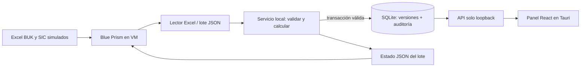

# Recorrido Blue Prism en la VM

La base incluye un lector invocable y un contrato, no un proceso Blue Prism exportado. La ejecución integrada debe implementarse y demostrarse en el entorno de la organización.

## Orquestación propuesta

1. Blue Prism toma el lote de una carpeta de entrada, comprueba que la copia terminó y le asigna una carpeta exclusiva.
2. Invoca `scripts/blueprism_ingest.py` desde el venv del proyecto, o el sidecar empaquetado con `--ingest`. El archivo `connection.json` debe corresponder a la aplicación abierta.
3. Espera el fin y lee el JSON de estado. Código 0: publicado/reutilizado; 2: validación rechazada; 3: fallo de comunicación/entorno.
4. Muestra `run_id`, `version` y `active_version`, o los errores de archivo/hoja/fila. Solo mueve el archivo a procesados cuando el estado es exitoso. Un rechazado va a revisión; no se transcribe ni corrige silenciosamente.
5. El panel consulta la versión persistida. Para la demo, vuelve al mismo profesional/mes y muestra antes/después, más un mes anterior conservado.

No ejecutar dos instancias de la aplicación con el mismo directorio de datos: cada arranque escribe su conexión efímera. En Linux el archivo de conexión tiene modo 0600. En Windows usar el perfil privado del usuario y sus permisos NTFS. El bot debe correr bajo esa misma cuenta autorizada o recibir un token dedicado mediante configuración segura; no copiar claves a logs ni al repositorio.

## Ejemplo de desarrollo (PowerShell)

```powershell
# Con npm run dev ya abierto:
.\.venv\Scripts\python.exe scripts/blueprism_ingest.py `
  --connection work/data/connection.json `
  --buk examples/BUK_base_demo.xlsx `
  --sic examples/SIC_demo.xlsx `
  --status work/corrida-001/estado.json

.\.venv\Scripts\python.exe scripts/blueprism_ingest.py `
  --connection work/data/connection.json `
  --buk examples/BUK_cambio_julio.xlsx `
  --reuse-sic `
  --status work/corrida-002/estado.json
```

Empaquetado Windows, ejecutando desde el directorio de instalación:

```powershell
.\botathon-api.exe --ingest `
  --connection "$env:APPDATA/cl.botathon.cadahoracuenta/connection.json" `
  --buk "C:/Botathon/entrada/BUK.xlsx" `
  --sic "C:/Botathon/entrada/SIC.xlsx" `
  --status "C:/Botathon/salida/lote-001/estado.json"
```

Los paths de la VM son ejemplos de configuración. Ajustarlos sin copiar secretos. Usar rutas entre comillas; no concatenar nombres no confiables en comandos de shell. Cada corrida debe tener su propio `estado.json` para no leer el resultado de otro lote.

La lectura alternativa del plan está cubierta: si Blue Prism no puede leer Excel de forma nativa, invoca este lector; el bot continúa tomando las decisiones de estado y coordinando el lote.

## Arquitectura para la lámina



Para escalar: completar catálogos/calendario y casos del kit, medir el lote completo y añadir autenticación institucional antes de distribuir acceso a más personas. La publicación actual es local: no abre un sitio ni envía reportes a jefaturas.
